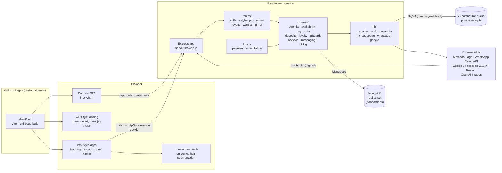
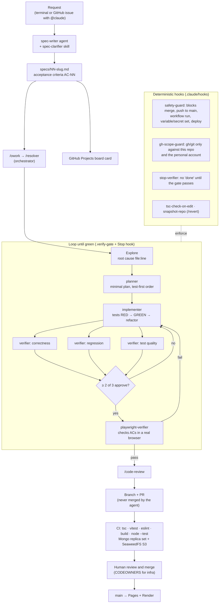

# ricorp.cl — personal site, WS Style booking platform and an AI-agent dev workflow

A MERN monorepo that serves two products from one codebase: **ricorp.cl**, a developer portfolio
(projects, career timeline, news, contact form), and **WS Style**, a full booking and loyalty
platform for a barbershop (online booking, barber and admin panels, payments, points, WhatsApp
notifications). It is also the testbed for a **spec-driven, multi-agent development workflow**
built on Claude Code: specs go in, verified pull requests come out, with deterministic safety hooks
and a GitHub Actions mode that can be driven from a phone.


---

## Architecture

### Runtime



**Client — `client/`** (React 19 + TypeScript + Vite, deployed to GitHub Pages)
- Vite **multi-page build** (`client/vite.config.ts`): the portfolio (`index.html`) and every WS Style
  route (`client/wstyle/**/index.html`: booking, account, gift cards, barber panel, admin sections,
  legal pages) are separate entry points, so three.js and the WS Style code never ship with the
  portfolio bundle. Each route is a real folder because Pages only serves existing paths.
- Post-build scripts prerender the WS Style landing and legal pages to static HTML
  (`scripts/prerender-wstyle.mjs`) and generate SPA fallbacks (`scripts/paginas-spa.mjs`).
- Portfolio components live in `client/src/components/` (Hero, Projects, News, Contact, DetailModal…),
  career data in `client/src/data/trayectoria.ts`, i18n in `client/src/i18n.tsx`.
- WS Style lives in `client/src/wstyle/`: `agenda/` (customer booking and account), `pro/` (barber
  panel, agenda, waitlist, payments, AI "mirror"), `admin/` (super-admin), `points/`, `gift/`,
  `scene/` + `seq/` + `fx/` (3D/scroll-sequence landing with three.js, GSAP and Lenis).

**Server — `server/`** (Express 4 + Mongoose 8, deployed to Render via `render.yaml`)
- `src/index.js` boots the app and background timers; `src/app.js` composes the app with
  **factory-based dependency injection** (`createAgenda`, `createPayments`, `createMailer`,
  `createWhatsAppClient`…), which is what lets tests swap in fakes for external APIs.
- `routes/` are thin HTTP adapters; `domain/` holds business rules (availability, pricing, deposits,
  loyalty points, waitlist, reviews, stats, tax vouchers); `lib/` wraps infrastructure (sessions,
  cookies, validation, mail, S3 receipts, OAuth, Mercado Pago, WhatsApp).
- `models/` defines ~30 Mongoose models (Business, Professional, Service, Appointment, SlotLock,
  PaymentEvent, PointsWallet, GiftCard, WaitlistEntry, Review, AuditLog…).

**Data — MongoDB.** Runs as a replica set because bookings and payments use multi-document
transactions (`server/src/lib/db.js`). Receipt files never go to Mongo: only metadata (key, type,
size, hash) is stored; the bytes go to a private S3-compatible bucket.

### Products inside the repo

| Product | What it does | Where |
|---|---|---|
| **Portfolio (ricorp.cl)** | Hero, projects slider, career timeline with posts, news, contact form with attachments (sent via Resend, SMTP fallback), static research/demo pages | `client/src/components/`, `client/src/data/`, `client/public/` |
| **WS Style — landing** | Scroll-driven 3D/image-sequence landing, services menu, reviews, location, CTA to book | `client/src/wstyle/App.tsx`, `scene/`, `seq/`, `fx/` |
| **WS Style — booking** | Slot availability, booking with slot locks, account, "my appointments", reviews, waitlist | `client/src/wstyle/agenda/`, `server/src/domain/agenda.js`, `availability.js`, `waitlist.js` |
| **WS Style — payments** | Mercado Pago Checkout Pro (webhook + periodic reconciliation, idempotent events), bank-transfer deposits with uploaded receipts, tax voucher backup | `domain/payments.js`, `deposits.js`, `billing.js`, `lib/receipts.js` |
| **WS Style — loyalty** | Points wallet, rewards catalog and redemption desk, gift cards with secret links | `domain/loyalty.js`, `giftcards.js`, `client/src/wstyle/points/`, `gift/` |
| **WS Style — barber panel** | Agenda, payments, redemptions, profile, style catalog, "mirror": on-device hair segmentation (ONNX) + AI hairstyle preview | `client/src/wstyle/pro/`, `routes/pro.js`, `routes/mirror.js` |
| **WS Style — admin** | Barbers, appointments, payments, messages, menu, styles, hours, stats, points, promo kit, settings, audit log | `client/src/wstyle/admin/`, `domain/admin.js`, `routes/admin.js` |
| **WS Style — messaging** | WhatsApp Cloud API templates and inbound webhook (dry-run mode without credentials), transactional email | `lib/whatsapp.js`, `domain/messaging.js`, `lib/emails.js` |

### Agent-driven development pipeline



- **Specs as the unit of work.** Every change starts as `specs/NN-<slug>.md` with numbered business
  rules and acceptance criteria; the same ACs are what the verifier panel and the Playwright agent
  check. The `specs/` folder is a readable history of how the product evolved.
- **Orchestrator + specialized agents** (`.claude/agents/`, `.claude/commands/owork.md`,
  `resolver.md`): `planner` never writes code, `implementer` works test-first, three `verifier`s
  review the diff in a fresh context with different lenses and must reach a 2-of-3 majority, and
  `playwright-verifier` confirms the result in the local app by reading the DOM.
- **Hooks instead of promises** (`.claude/settings.json`, `.claude/hooks/`): production-affecting
  commands are denied by a PreToolUse hook unless a human creates an escape marker; a Stop hook
  keeps the agent iterating while the verification command fails.
- **GitHub mode** (`.github/workflows/claude.yml`): writing `@claude` in an issue or PR review runs
  the same pipeline on a runner with an ephemeral Mongo replica set, a local S3 (SeaweedFS) and
  headless Playwright. The agent drafts specs and asks numbered multiple-choice questions in the
  issue, implements on a `claude/issue-N-*` branch, opens a PR and stops; humans merge.
- **Board automation** (`.github/workflows/board-sync.yml`, `.github/claude/board.sh`): issues and
  PRs move their cards (Todo → In Progress → Done) without manual updates.
- **Branch protection**: `CI / pruebas` is a required check, PRs need an approval from someone other
  than the author, and `.github/CODEOWNERS` requires the owner's review for infrastructure files.

---

## Key design decisions

- **Static front, stateless API.** The front is a static multi-page build on Pages (custom domain);
  all state lives behind the Express API on Render. CORS origins are an explicit allow-list
  (`ALLOWED_ORIGINS`).
- **Server-authoritative payments.** The client only receives a checkout URL; payment status changes
  only from what the Mercado Pago API returns (webhook signature check, monotonic transitions,
  unique `PaymentEvent` index for idempotency, plus a reconciliation timer for lost webhooks).
- **Sessions without JWTs in the browser.** Random token in an `httpOnly` cookie, only its SHA-256
  hash stored in Mongo, so logout and revocation take effect server-side (`lib/session.js`).
- **Pluggable storage and channels.** Receipts use an `fs` driver locally and an S3 driver in
  production (any S3-compatible provider, SigV4 signed by hand with `fetch`, no SDK); file types are
  validated by content, not extension. WhatsApp and email fall back to dry-run without credentials.
- **Real infrastructure in tests.** Server integration tests (`server/test/`, `node --test`) run
  against a real Mongo replica set and a real S3 implementation; only third-party HTTP APIs are faked
  (`mp-fake.js`, `wa-fake.js`).
- **Bundle isolation.** Separate Vite entries and a `three` alias to its ESM sources keep 3D code out
  of the portfolio and defer the WebGL renderer until needed.

---

## Tech stack

| Layer | Technologies |
|---|---|
| Client | React 19.3, TypeScript 6.0, Vite 8, three.js 0.170, GSAP 3.15, Lenis 1.3, onnxruntime-web 1.22, qrcode-generator |
| Client tooling | Vitest 5, ESLint 10 + typescript-eslint, react-hooks plugin |
| Server | Node.js 24, Express 4.22, Mongoose 8, multer 2, sharp 0.35, bcryptjs, Resend 6, Nodemailer 10 |
| Data | MongoDB (replica set), S3-compatible object storage |
| Integrations | Mercado Pago Checkout Pro, WhatsApp Cloud API, Google and Facebook OAuth, OpenAI Images, Nominatim geocoding |
| Delivery | GitHub Pages, Render (`render.yaml` blueprint), GitHub Actions (CI, Pages, Claude, board sync) |
| AI workflow | Claude Code agents, commands, skills and hooks; `anthropics/claude-code-action`; Playwright MCP |

---

## Project structure

```
.
├── .claude/
│   ├── agents/          # spec-writer, planner, implementer, verifier, playwright-verifier
│   ├── commands/        # /owork, /resolver, /start, /push, /revert …
│   ├── hooks/           # safety-guard, gh-scope-guard, stop-verifier, tsc-check-on-edit, snapshot-repo
│   ├── skills/          # spec-clarifier
│   └── settings.json    # permissions + hook wiring
├── .github/
│   ├── workflows/       # ci.yml, deploy-pages.yml, claude.yml, board-sync.yml
│   ├── ci/s3-local.sh   # SeaweedFS S3 for tests
│   ├── claude/          # MCP config + board script for the runner
│   └── CODEOWNERS
├── client/
│   ├── index.html       # portfolio entry
│   ├── wstyle/          # one index.html per WS Style route (Pages-friendly)
│   ├── scripts/         # prerender + SPA fallbacks + banner generators
│   ├── public/          # static assets, design frames, demo pages
│   └── src/
│       ├── components/  # portfolio sections
│       ├── data/ lib/ hooks/
│       └── wstyle/      # agenda/, pro/, admin/, points/, gift/, scene/, seq/, fx/, legal/
├── server/
│   ├── src/
│   │   ├── app.js index.js
│   │   ├── routes/ domain/ lib/ models/
│   │   └── seed*.js     # catalog, admin and demo data
│   └── test/            # node --test integration suites
├── specs/               # NN-<slug>.md requirements with acceptance criteria
├── docs/                # operational notes (receipt storage)
└── render.yaml          # backend blueprint
```

---

## Getting started

Requirements: Node.js 24 and a local MongoDB **started as a replica set** (transactions are used).

```bash
# MongoDB (example with Docker)
docker run -d --name mongo -p 27017:27017 mongo:8 --replSet rs0 --bind_ip_all
docker exec mongo mongosh --quiet --eval 'rs.initiate({_id:"rs0",members:[{_id:0,host:"localhost:27017"}]})'

# API  → http://127.0.0.1:4000  (GET /api/health)
cd server && npm install && cp .env.example .env && npm run dev
npm run seed            # catalog / demo data (see package.json for seed:* variants)

# Web  → http://127.0.0.1:5173  (portfolio at /, WS Style at /wstyle/)
cd client && npm install && npm run dev
```

Quality gate (same commands as CI):

```bash
cd client && npx tsc -b --noEmit && npx vitest run && npm run lint && npm run build
cd server && npm test   # needs MONGO_TEST_URI pointing to a replica set
```

Every third-party integration is optional locally: without credentials, email and WhatsApp run in
dry-run mode, receipts use the local `fs` driver, and OAuth / Mercado Pago / AI preview stay disabled.
The full list of variables is in `server/.env.example`; production secrets are configured only in the
hosting dashboards (`sync: false` in `render.yaml`) and never committed.

### Deploy

- **Front:** every push to `main` runs `.github/workflows/deploy-pages.yml` (build-time variable
  `VITE_API_URL` = public API URL).
- **Back:** Render Blueprint from `render.yaml` (service root `server/`, health check `/api/health`).
- Merging to `main` redeploys both; agents are blocked from doing it by `safety-guard.sh`.

---

## My role

Designed and implemented the whole system end to end: the React/TypeScript front, the Express/MongoDB
API and its integrations, the CI/CD pipeline, and the Claude Code agent workflow (agents, hooks,
GitHub Actions mode) used to build it.

---

## Resumen en español

Monorepo MERN que sirve el portafolio de ricorp.cl y WS Style, una plataforma de reservas para una
barbería (agenda, panel del barbero y del admin, pagos con Mercado Pago, señas con comprobante en S3,
puntos, gift cards y avisos por WhatsApp). Front en React 19 + TS + Vite sobre GitHub Pages; API
Express + Mongoose en Render; MongoDB como replica set. Se desarrolla con un flujo de agentes de
Claude Code: spec → /owork (Explore → planner → implementer test-first → 3 verifiers → Playwright),
con hooks que bloquean deploys y un modo GitHub Actions activado con `@claude`; los merges los hace
siempre una persona.
